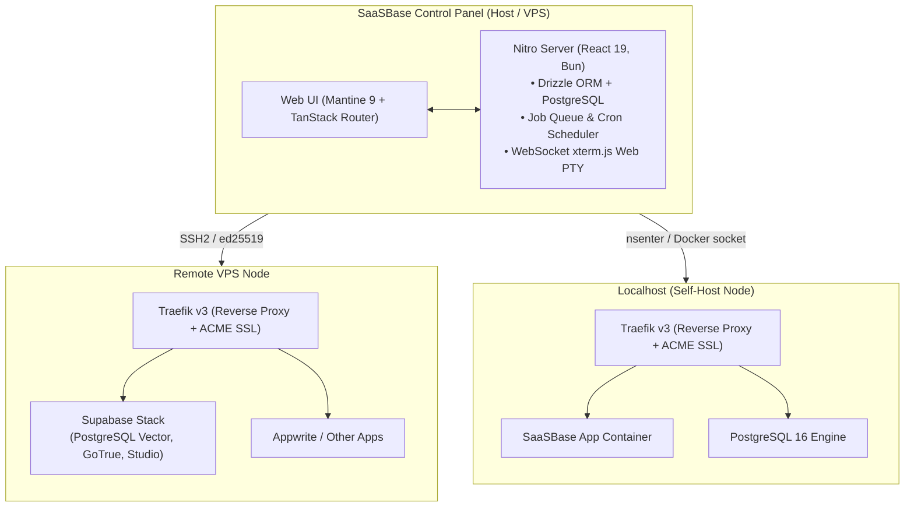

SaaSBase is engineered with an efficient, monolithic control plane that communicates with managed VPS nodes via lightweight, secure protocols.

## High-Level Topology

## Key Architectural Principles

1. **In-Process Single-Instance Core:** Background jobs, cron schedulers, and server locking mechanisms execute directly in-process for predictable memory consumption and instant synchronization.
2. **Stateless Node Management:** Remote nodes run standard Docker and Traefik containers. SaaSBase leaves no heavy monitoring agents or resident daemons on your target servers.
3. **End-to-End Type Safety:** Fully unified TypeScript codebase leveraging Drizzle ORM, Zod validation schemas, and TanStack React Start.
