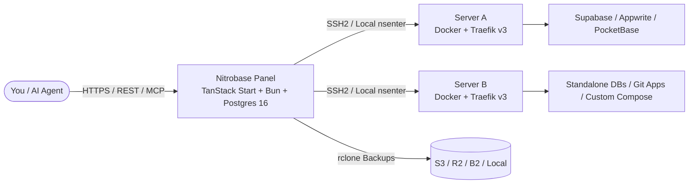

Nitrobase runs as a single-instance control plane (one app container + one PostgreSQL 16 container) that manages one or more Linux servers over SSH or local host execution—without installing resident agents or Kubernetes on your servers.

## High-Level Topology



## Control Plane

- **Single-instance design:** Run **one** Nitrobase panel instance per database. Job queues, per-server and per-app locks, cron schedulers (backups, monitoring, update checks, scheduled tasks), and SSE/WebSocket streams live in-process for predictable memory usage (~300 MB RAM) and zero external broker overhead.
- **Database:** Bundled `postgres:16-alpine` (never published to the host network) accessed via Drizzle ORM.
- **Secrets at rest:** All sensitive values (SSH keys, app env vars, database passwords, backup destination credentials, notification secrets) are encrypted with `ENCRYPTION_KEY` using AES-256-GCM + HKDF-SHA256 (Format v3).

## Managed Server Layout

Every managed server runs standard Docker Engine and a **Traefik v3** reverse proxy (`nitrobase-traefik`). Nitrobase stores all managed state under `NITROBASE_ROOT` (default `/etc/nitrobase`):

```text
/etc/nitrobase/
  apps/<folder>/                  # Rendered docker-compose.yml, .env (0600), service-env/, app data
  traefik/
    traefik.yml                   # Static Traefik v3 config
    dynamic/
      middlewares.yml             # Shared security headers & middlewares
      app-<key>.yml               # Flat per-app routing files
    acme/acme.json                # Let's Encrypt certificates
  tunnel/cloudflared.env          # Cloudflare Tunnel token (0600), when enabled
  backup-work/                    # Ephemeral staging area (swept after jobs)
  git-inspect/                    # Ephemeral shallow clones during Git wizard inspection
```

## Network Isolation

- **Per-app private network:** Each app's compose services communicate on their own private Docker default network.
- **Shared proxy network (`nitrobase-network`):** Compose files are never allowed to declare `nitrobase-network` directly. Instead, Nitrobase attaches only routed containers (`nitrobase.routed=true`) after `up`/`start` by **container name only** (no service-name alias), preventing two apps with a `kong` or `web` service from colliding.
- **Per-link database networks (`nitrobase-link-<id>`):** Linking an app to a standalone database attaches only the linked containers to a dedicated bridge network.
- **Isolated tunnel network (`nitrobase-tunnel`):** When Cloudflare Tunnel is enabled, Traefik binds its private tunnel entrypoint (`:8081`) on a dedicated subnet (`172.31.254.0/29`) reachable only by `nitrobase-cloudflared`, never by app containers or the public internet.
- **Panel network (`nitrobase-panel`):** When serving the panel itself through Traefik, Traefik reaches `nitrobase_app:3000` over a dedicated private network.

## Jobs & Locks

Deployments, backups, restores, updates, moves, and server bootstraps run as tracked **Jobs** with live log streaming (SSE), per-server and per-app locking, and clean startup recovery if the panel restarts mid-job.
