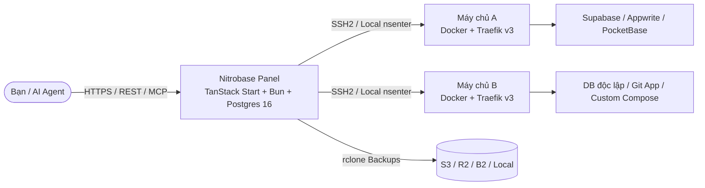

Nitrobase vận hành như một control plane đơn thể (1 container ứng dụng + 1 container PostgreSQL 16) quản lý một hoặc nhiều máy chủ Linux qua SSH hoặc thực thi cục bộ — không cài agent nặng hay Kubernetes lên máy chủ đích.

## Sơ đồ tổng quan



## Control Plane

- **Thiết kế một phiên bản duy nhất (Single-Instance):** Chạy **một** phiên bản Nitrobase panel cho mỗi cơ sở dữ liệu. Hàng đợi job, khóa theo máy chủ/ứng dụng, bộ lập lịch cron (sao lưu, giám sát, kiểm tra cập nhật, tác vụ định kỳ) và luồng SSE/WebSocket đều chạy trực tiếp trong tiến trình để tiêu tốn bộ nhớ ổn định (~300 MB RAM) và không cần message broker ngoài.
- **Cơ sở dữ liệu:** Container `postgres:16-alpine` đi kèm (không mở cổng ra host), truy vấn qua Drizzle ORM.
- **Mã hóa bí mật khi lưu trữ:** Mọi thông tin nhạy cảm (khóa SSH, biến môi trường, mật khẩu DB, khóa kho sao lưu, cấu hình thông báo) đều được mã hóa bằng `ENCRYPTION_KEY` theo chuẩn AES-256-GCM + HKDF-SHA256 (Format v3).

## Bố cục trên máy chủ được quản lý

Mỗi máy chủ chạy Docker Engine tiêu chuẩn và reverse proxy **Traefik v3** (`nitrobase-traefik`). Toàn bộ dữ liệu quản lý nằm dưới `NITROBASE_ROOT` (mặc định `/etc/nitrobase`):

```text
/etc/nitrobase/
  apps/<folder>/                  # docker-compose.yml đã biên dịch, .env (0600), service-env/, dữ liệu app
  traefik/
    traefik.yml                   # Cấu hình tĩnh Traefik v3
    dynamic/
      middlewares.yml             # Middleware bảo mật dùng chung
      app-<key>.yml               # File định tuyến phẳng cho từng ứng dụng
    acme/acme.json                # Chứng chỉ Let's Encrypt
  tunnel/cloudflared.env          # Token Cloudflare Tunnel (0600) khi bật
  backup-work/                    # Thư mục tạm tạo bản sao lưu (tự dọn sau job)
  git-inspect/                    # Thư mục clone tạm khi kiểm tra kho Git
```

## Cô lập mạng

- **Mạng riêng theo từng ứng dụng:** Các service trong cùng một ứng dụng giao tiếp trên mạng mặc định riêng biệt của Docker Compose.
- **Mạng proxy dùng chung (`nitrobase-network`):** File compose không bao giờ được khai báo trực tiếp `nitrobase-network`. Nitrobase chỉ gắn các container cần định tuyến (`nitrobase.routed=true`) sau lệnh `up`/`start` bằng **tên container duy nhất** (không tạo alias theo tên service), tránh xung đột khi hai ứng dụng cùng có service tên `kong` hay `web`.
- **Mạng liên kết DB (`nitrobase-link-<id>`):** Khi liên kết ứng dụng với cơ sở dữ liệu độc lập, chỉ container của ứng dụng và DB đó được gắn vào một mạng bridge riêng.
- **Mạng tunnel cô lập (`nitrobase-tunnel`):** Khi dùng Cloudflare Tunnel, Traefik lắng nghe cổng tunnel riêng (`:8081`) trên dải mạng `172.31.254.0/29` chỉ có `nitrobase-cloudflared` truy cập được, cô lập hoàn toàn với các ứng dụng và Internet công cộng.
- **Mạng panel (`nitrobase-panel`):** Mạng riêng nối giữa Traefik và `nitrobase_app:3000` khi cấu hình tên miền HTTPS cho bảng điều khiển.

## Job & Khóa đồng bộ

Triển khai, sao lưu, khôi phục, cập nhật, di chuyển ứng dụng và khởi tạo máy chủ đều chạy dưới dạng **Job** có theo dõi log trực tiếp qua SSE, khóa đồng bộ theo máy chủ/ứng dụng và cơ chế phục hồi an toàn nếu panel khởi động lại giữa chừng.
