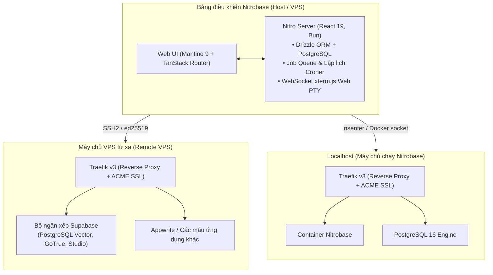

Nitrobase được thiết kế với trung tâm điều khiển (Control Plane) tinh gọn, giao tiếp với các máy chủ VPS được quản trị thông qua các giao thức an toàn.

## Sơ đồ kiến trúc tổng thể

## Các nguyên lý thiết kế cốt lõi

1. **Tiến trình đơn (Single-Instance In-Process):** Các background job, tác vụ cron và khóa server lock được vận hành trực tiếp trong tiến trình bộ nhớ của Nitrobase, đảm bảo không xung đột và không cần cài thêm Redis.
2. **Không cài đặt Agent nặng nề:** Các server từ xa chỉ chạy Docker và Traefik v3 tiêu chuẩn. Nitrobase không cài daemon chạy ngầm làm chậm máy chủ của bạn.
3. **An toàn kiểu dữ liệu toàn diện (Type Safety):** 100% mã nguồn TypeScript đồng bộ từ cơ sở dữ liệu (Drizzle ORM), Zod validation cho tới giao diện người dùng React 19.
